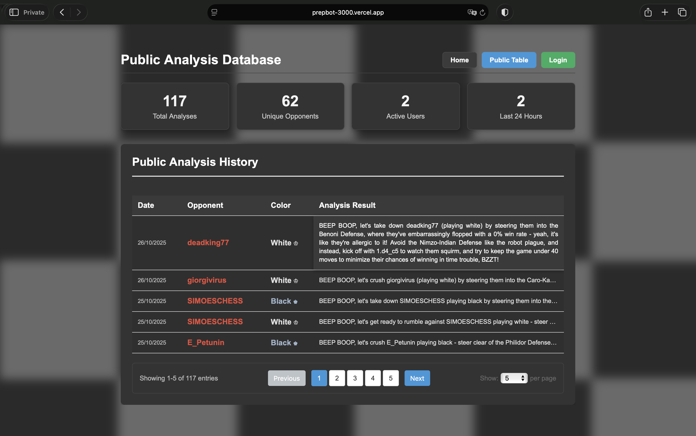
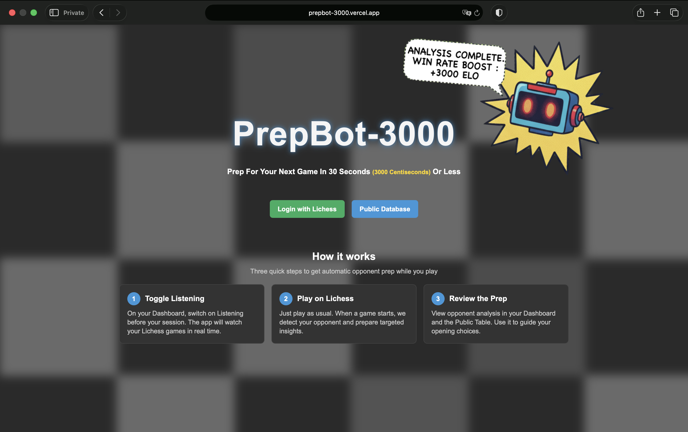
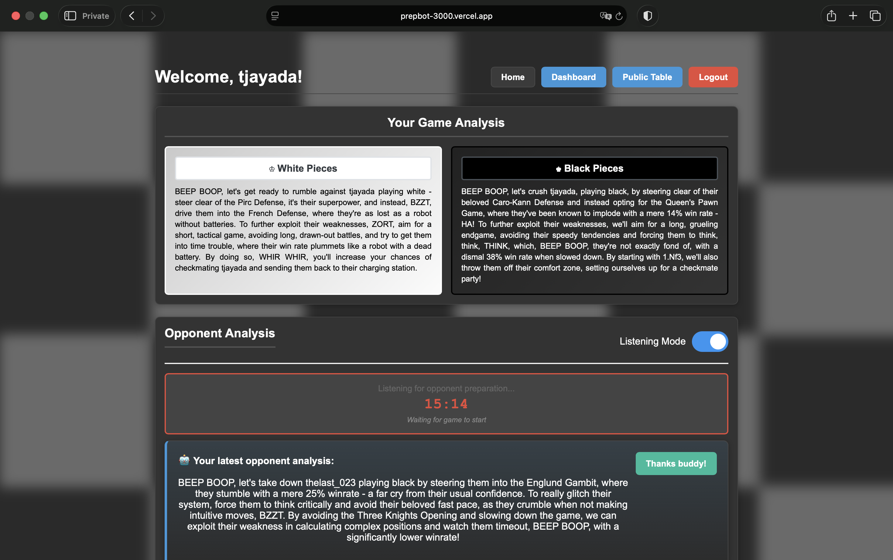

 <div align="center">
 	<a href="https://prepbot-3000.vercel.app">
    	
  	</a>
  	<h3>
   		<b>
      		PrepBot-3000
   		</b>
  </h3>
  <b>
    Fun AI-Powered Chess Prep Tool For Lichess
  </b>
  <p>

 [](Chttps://prepbot-3000.vercel.app) 

[](https://github.com/tjayada/PrepBot-3000?tab=MIT-1-ov-file) 
  </p>
  
  
  
   
</div>


_A fun chess preparation tool that analyzes your Lichess opponents in real-time._

<br>

## Table of Contents

<details>
<summary>"Click to expand"</summary>

1. [The Premise](#the-premise)
2. [Features](#features)
3. [How It Works](#how-it-works)
	* [User Flow](#user-flow) 
	* [Analysis Pipeline](#analysis-pipeline)
4. [Architecture](#architecture)
5. [Key Technical Details](#key-technical-details)
7. [Deployment](#deployment)
8. [Project Structure](#project-structure)
9. [Screenshots](#screenshots)
10. [Contributing](#contributing)
11. [License](#license) 
12. [Acknowledgments](#acknowledgments)
13. [Disclaimer](#disclaimer)

</details>


<br>

## The Premise

While professional chess players spend considerable amount of time preparing for a single opponent, this project lovingly mocks that idea by generating "comprehensive" opponent analysis in about 30 seconds, so just enough time between pairing and having to make the first move.

The bot analyzes your opponent's recent games, extracts the most influential patterns using information gain, and generates personalized preparation advice with a dash of AI personality. All while you're deciding between 1.e4 and 1.d4.


---
> We all deserve state-of-the-art opening prep for those crucial 3+0 blitz games at 2 AM. 🧑‍💻

— Nobody, ever

<br>

## Features

| Feature| Description |
|-----:|-----------|
|     **Real-time Analysis**| Automatically detects new games and generates opponent prep on the fly|
|     **Statistical Insights** | Uses information gain to identify the most predictive features in an opponent's play    |
|     **AI-Powered Recommendations**| LLM adds personality and context to statistical patterns       |
|     **Fast & Lightweight**| Analysis completes before the game officially starts|
|     **Color-Specific Prep**| Separate analysis for when your opponent plays white vs black |
|     **Live Dashboard**| WebSocket updates deliver fresh analysis as games start |
|     **Public Table**| View and share interesting analyses from the community |


<br>


## How It Works 

### User Flow

1. **Visit Home** : Learn about the project, view public data and login

2. **Login via Lichess** : OAuth authentication with your Lichess account

3. **Access Dashboard** : View your analysis history

4. **Toggle Listening Mode** : Start monitoring your Lichess games (for 20 minutes)

5. **Play Games** : Just play normally on Lichess

6. **Get Auto-Prep** : Analysis appears in your dashboard as opponents are detected

7. **Review Prep** : Check opponent tendencies, opening preferences, and recommended lines

---

### Analysis Pipeline

1. **Fetch Recent Games**  
Retrieves opponent's last 50 rated games (blitz, rapid, classical)

2. **Feature Extraction**  
Analyzes opening preferences, time management, game length, and decision-making habits

3. **Information Gain Calculation**  
Identifies which features most strongly predict game outcomes

4. **Context Building**  
Packages top insights with statistical context

5. **LLM Enhancement**  
Groq API adds personality and actionable recommendations

6. **Display**  
Results appear in interactive tables on the dashboard


<br>


## Architecture

### Frontend
- **Tech Stack**: Vanilla HTML, CSS, JavaScript
- **Deployment**: Vercel
- **Features**:
  - Responsive design
  - WebSocket integration for real-time updates
  - Interactive analysis tables
  - Public table for community insights

### Backend
- **Tech Stack**: Python 3.14, FastAPI
- **Deployment**: Render
- **Key Libraries**:
  - `berserk`: Lichess API client
  - `pandas` & `numpy`: Statistical analysis
  - `groq`: LLM inference
  - `supabase`: Database (PostgreSQL)
  - `fastapi`: High-performance web framework

### Database (Supabase)
- **users**: Authentication, session management
- **analytics**: Analysis results, caching

### External APIs
- **Lichess API**: Game data, authentication
- **Groq API**: LLM inference for analysis generation

<br>

## Key Technical Details

### Information Gain Methodology

The analysis uses information gain, a measure from decision tree theory, to identify the most influential features:

- **Categorical Features**: Opening ECO codes, opening names, time trouble indicators
- **Numeric Features**: Percentage of moves faster than average, critical overthinking count, game length
- **Wilson Score**: Balances win rate with statistical confidence (accounts for small sample sizes)

### Caching Strategy

- **Analysis Cache**: 7 days for successful analyses
- **Error Cache**: 1 day for failed analyses
- Prevents redundant computation and API calls

### Security

- **PKCE OAuth Flow**: Secure authentication without storing credentials
- **Fernet Encryption**: Access tokens encrypted at rest
- **JWT Sessions**: Stateless session management
- **Rate Limiting**: Prevents abuse (10/minute for analysis, 5/minute for listening)

<br>

## Deployment

### Environment Variables

**Backend:**

```bash
SECRET_KEY=<jwt-secret>
LICHESS_CLIENT_ID=<lichess-oauth-client-id>
BASE_URL=<backend-url>
FRONTEND_URL=<frontend-url>
SUPABASE_URL=<supabase-url>
SUPABASE_KEY=<supabase-key>
GROQ_API_KEY=<groq-api-key>
ENCRYPTION_KEY=<fernet-encryption-key>
ENVIRONMENT=production
PORT=8000
```


### Run Locally

**Backend:**

```bash
cd backend
python -m venv venv
source venv/bin/activate
pip install -r requirements.txt
uvicorn main:app --reload --host 0.0.0.0 --port 8000
```

**Frontend:**

I sometimes experienced trouble because of cross-origin errors and similar, so the easiest often was to uncomment / comment the following lines 3-6 in [script.js](frontend/script.js) 

```javascript
//window.API_BASE_URL = window.location.hostname === 'localhost' 
//  ? 'http://localhost:8000'  // Development
//  : 'https://prepbot-3000.onrender.com';  // Production
window.API_BASE_URL = window.API_BASE_URL || window.location.origin.replace(':3000', ':8000');
```
and then simply

```bash
cd frontend
python -m http.server 3000
```

---

## Project Structure

```
prepbot-3000/
├── backend/
│   ├── main.py              # FastAPI app, routes, authentication
│   ├── analysis.py          # Feature extraction, information gain
│   ├── llm_service.py       # Groq integration, prompt building
│   └── requirements.txt     # Python dependencies
├── frontend/
│   ├── index.html           # Landing page
│   ├── 404.html             # 404 Page
│   ├── assets/              # Favicons and images
│   ├── dashboard/           # User dashboard
│   ├── public_table/        # Table with all preps
│   ├── callback/            # Re-direct page from Lichess
│   ├── components/          # Reusable UI components
│   ├── css/                 # CSS styling for web app
│   └── script.js            # Client-side logic
├── images                   # Screenshots of app
├── .gitignore               
├── LICENSE                  # MIT License
└── README.md                # You are here

```

<br>

## Screenshots






<br>


## Contributing

This is a passion project built for laughs and learning. 
If you still want to contribute:

1. Fork the repo
2. Create a feature branch
3. Make your changes (with appropriate jokes)
4. Submit a pull request

<br>

## License

See [LICENSE](LICENSE) file for details.

<br>

## Acknowledgments

- [Lichess](https://lichess.org) for the excellent API
- [Groq](https://groq.com) for lightning-fast LLM inference
- The chess community for inspiration (and opponents)

<br>

## Disclaimer

This tool is for entertainment purposes. The analysis is based on statistical patterns and should not be taken as serious chess preparation. Your win rate may or may not increase by exactly 3000 ELO. Use at your own discretion.

**Happy prepping!** 🎭♟️🤖
